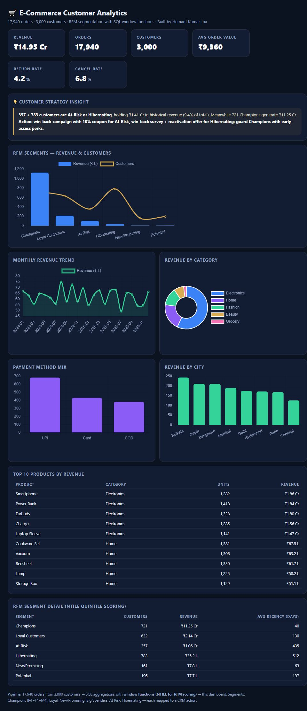

**Live Dashboard:** https://hemantkjha-data.github.io/ecommerce-customer-analytics/dashboard/

# 🛒 E-Commerce Customer Analytics — RFM Segmentation

**Business question:** *Which customers drive our revenue, which are slipping away, and where should CRM spend go?*



## ▸ Project Highlights

▸
Analysed 17,940 orders from 3,000 customers (₹14.95 Cr revenue, ₹9,360 AOV) across categories, cities and payment channels.
▸
Segmented the entire customer base with **SQL window functions (NTILE quintile scoring)** — Recency, Frequency, Monetary mapped to 6 actionable segments.
▸
Found extreme revenue concentration — 721 Champions (24% of customers) generate 75% of revenue (₹11.25 Cr).
▸
Flagged the leakage — 1,140 customers are At-Risk (avg 435 days dormant) or Hibernating, holding ₹1.41 Cr of historical revenue, and mapped each segment to a CRM action.

## 📁 Repo Structure

```
├── data/
│   ├── data.csv          # 17,940 order records (synthetic, deterministic)
│   └── data.db           # SQLite database
├── sql/
│   └── queries.sql       # 10 annotated queries incl. the RFM showcase
└── dashboard/
    ├── index.html        # Interactive dashboard (Chart.js)
    ├── agg_data.json
    └── screenshot.jpg
```

## 🚀 How to Run

1. **Dashboard:** open `dashboard/index.html` in any browser.
2. **SQL:** `sqlite3 data/data.db < sql/queries.sql`

## 🔍 Showcase Query — RFM with Window Functions

```sql
WITH rfm AS (
  SELECT customer_id,
         julianday('2025-12-31') - julianday(MAX(order_date)) AS recency,
         COUNT(*) AS frequency,
         SUM(revenue) AS monetary,
         NTILE(5) OVER (ORDER BY julianday(MAX(order_date))) AS r_score,
         NTILE(5) OVER (ORDER BY COUNT(*)) AS f_score,
         NTILE(5) OVER (ORDER BY SUM(revenue)) AS m_score
  FROM orders WHERE status='Delivered' GROUP BY customer_id
)
SELECT CASE
         WHEN r_score>=4 AND f_score>=4 AND m_score>=4 THEN 'Champions'
         WHEN r_score>=3 AND f_score>=3 THEN 'Loyal Customers'
         WHEN r_score>=4 AND f_score<=2 THEN 'New/Promising'
         WHEN r_score>=3 AND m_score>=4 THEN 'Big Spenders'
         WHEN r_score<=2 AND f_score>=3 THEN 'At Risk'
         WHEN r_score<=2 AND f_score<=2 THEN 'Hibernating'
         ELSE 'Potential' END AS segment,
       COUNT(*) customers, SUM(monetary) revenue, ROUND(AVG(recency),0) avg_recency_days
FROM rfm GROUP BY segment ORDER BY revenue DESC;
```

## 💡 Analytical Takeaways & CRM Actions

| Segment | Customers | Revenue | Action |
|---|---|---|---|
| Champions | 721 | ₹11.25 Cr | Guard with early-access perks; never spam |
| Loyal Customers | 632 | ₹2.14 Cr | Cross-sell into adjacent categories |
| At Risk | 357 | ₹1.06 Cr | Win-back campaign + 10% coupon |
| Hibernating | 783 | ₹0.35 Cr | Reactivation offer or deliberate sunset |
| New/Promising | 161 | ₹0.08 Cr | Onboarding journey to 2nd purchase |

1. **75% of revenue sits with 24% of customers** — retention beats acquisition on pure economics here.
2. **Dormancy is measurable** — At-Risk customers average 435 days since last order; recency scoring turns "we think they left" into a list.
3. **One-time buyers are the biggest count, smallest value** — 1,354 one-time customers (45%) contribute only ₹1.18 Cr; the 2nd-purchase journey is the highest-leverage funnel fix.

---

*Dataset is synthetic and generated deterministically for portfolio demonstration. All figures are computed from the data via the SQL in `sql/queries.sql`.*

**Built by Hemant Kumar Jha** · Data Analyst · SQL · Python · Dashboards
